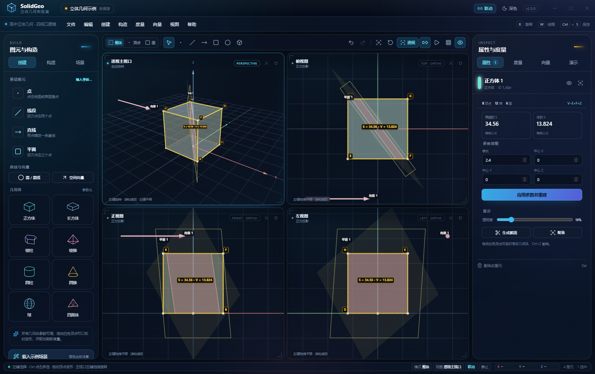
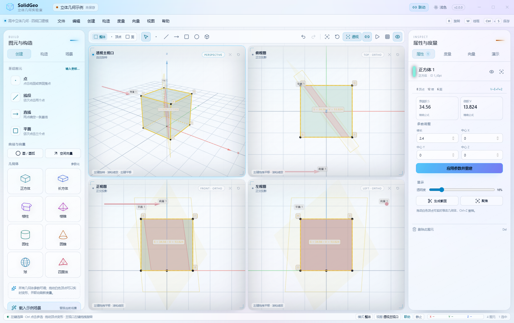
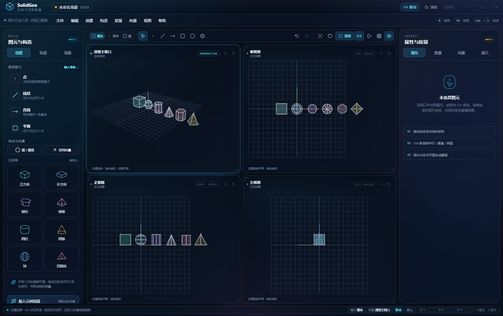
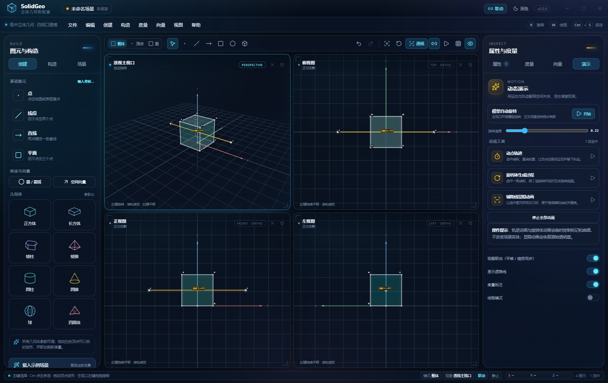
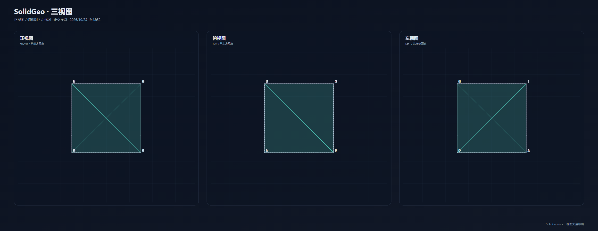

# SolidGeo · 立体几何

> 面向高中立体几何教学的 Windows 11 四视口三维建模软件。  
> 透视主视口 + 正视图 / 俯视图 / 左视图，共享同一场景；建模、关系判定、实时度量、空间向量、截面切割与动画演示一体化。



**v2.0.0** · Electron 45 / Edge Web Edition · React 19 · Three.js r186 · TypeScript · 离线可用

---

## 目录

- [这个软件能做什么](#这个软件能做什么)
- [下载与启动](#下载与启动)
- [界面速览](#界面速览)
- [五分钟上手](#五分钟上手)
- [功能清单](#功能清单)
- [快捷键](#快捷键)
- [工程文件格式](#工程文件格式)
- [开发与调试](#开发与调试)
- [打包 exe](#打包-exe)
- [版本保留规则](#版本保留规则)
- [目录结构](#目录结构)
- [测试与验证](#测试与验证)
- [上传到 GitHub](#上传到-github)
- [已知限制](#已知限制)
- [许可证](#许可证)

---

## 这个软件能做什么

SolidGeo 把立体几何课堂上最常用的操作放到一个界面里：

- **四视口同步**：透视主视口、俯视图、正视图、左视图共享同一场景，每个视口有独立相机；正交视口实时反映模型的变化。
- **参数化建模**：点、线段、直线、平面、圆/圆弧、空间向量，以及正方体、长方体、棱柱、棱锥、圆柱、圆锥、球、四面体八种预设几何体。
- **直接拖动顶点**：所有白色顶点都可以拖动变形，关联的线段、平面、截面、度量结果实时刷新。
- **自动关系判定**：选中两个或多个图元，立即给出平行、垂直、共线、共面、异面、相交、线面包含等结论。
- **实时度量**：长度、弧长、两线夹角、线面角、二面角、异面直线角、点线距、点面距、平行线/面间距、截面积、表面积、体积。
- **空间向量实验室**：a+b、a−b、λa、a·b、a×b、模长、单位向量、夹角、投影、方向余弦，并给出「向量法求线面角 / 二面角」的逐步推导。
- **截面与切割**：用场景中的任意平面或轴向平面裁切立体，高亮截痕、填充截面、可开启剖切显示，可单独导出截面 SVG / OBJ。
- **三视图输出**：一键导出正视图、俯视图、左视图组成的教学图纸 SVG。
- **动画演示**：模型自动旋转、动点轨迹、绕 Z 轴生成旋转体、辅助线呼吸显隐。
- **导出**：当前视图 2× PNG、当前视图 SVG、三视图 SVG、场景 OBJ、工程 `.geojson`。
- **Windows 11 原生质感**：无边框透明窗口 + Acrylic 磨砂；深色 / 浅色主题即时切换，全部界面与图标本地加载。

### 两套主题

| 深色 | 浅色 |
| --- | --- |
|  |  |

### 八种几何体与动画





### 三视图矢量图纸



---

## 下载与启动

> **如果双击 `SolidGeo-2.0.0-Portable.exe` 没有任何反应，请直接使用下面的 Web Edition。**
>
> 这不是你没有输入命令，也不是文件没下载完整。当前这台机器的 Windows 11 版本为 **build 26200**，Electron 在该版本上存在 Chromium 沙箱兼容问题：本机实测 Electron 22 / 28 / 31 / 35 / 45 的便携版与最小测试程序都会在启动阶段直接退出（`STATUS_BREAKPOINT / 0xC0000005`），不会弹出窗口。相同的一套 SolidGeo 前端代码在 Edge 155 内核中运行正常。
>
> 因此这里额外提供了一个**双击即用、无需任何命令**的 Web Edition（Edge 应用窗口）。

### 推荐：SolidGeo Web Edition（本机已验证；含两步兼容方式）

| 文件 | 说明 |
| --- | --- |
| `releases/v2/SolidGeo-2.0.0-Web/启动SolidGeo.vbs` | 双击启动，无需命令（优先） |
| `releases/v2/SolidGeo-2.0.0-Web/启动服务.cmd` | 固定端口 47821 本地服务 + 默认浏览器（兼容模式） |
| `releases/v2/SolidGeo-2.0.0-Web/打开SolidGeo.url` | 浏览器打开本地 SolidGeo 页面 |
| `releases/v2/SolidGeo-2.0.0-Web/启动SolidGeo.cmd` | 如果 VBS 无反应，用这个查看错误 / 启动 |
| `releases/v2/SolidGeo-2.0.0-Web.zip` | 整个 Web Edition 的压缩包（SHA-256 `52D2CDEF63529FDB8B7FF41B56FA98950A78033818B7589BAEBA6AFDD39C0CCE`） |
| 项目根目录 `启动SolidGeo.vbs` | 直接在源码目录中启动 |

**优先操作：** 进入 `releases/v2/SolidGeo-2.0.0-Web`，双击 **`启动SolidGeo.vbs`**。约 2–5 秒后会出现 Edge 应用窗口；不需要输入任何命令。

**如果 Edge 窗口出现后自动关闭：** 这台机器的浏览器窗口在脚本启动时可能被本机安全软件/系统策略自动关闭。使用两步方式即可：

1. 双击 **`启动服务.cmd`**，保留随后出现的控制台窗口（它是本地静态服务，不联网）；
2. 浏览器没有自动出现时，双击 **`打开SolidGeo.url`**；或直接在 Edge 地址栏打开 `http://127.0.0.1:47821/index.html?web=1`；
3. 使用完关闭浏览器，再关闭控制台窗口。

这也解释了为什么 Electron exe 会“毫无反应”：它在这台 Windows 11 build 26200 上无法完成 Chromium 初始化，且 Electron 的 Chromium 版本比系统 Edge 旧，没有可用的兼容修复。

**运行要求：**

- Microsoft Edge（本机已安装 155 内核）。
- Node.js 22+（本机已安装，`node` 在 PATH 中）。
- 启动器只在本机 `127.0.0.1` 上临时提供静态文件，关闭窗口后自动退出，不会上传任何数据。
- 由于是 Edge 应用窗口，没有 Electron 的透明 Acrylic 系统背景；应用内部的毛玻璃面板、深色/浅色主题、四视口与全部功能保持不变。
- 保存 / 导出使用浏览器的下载目录；打开工程使用系统文件选择器。

### Electron 便携版（适用于兼容的 Windows 环境）

| 版本 | 文件 | 大小 | SHA-256 |
| --- | --- | --- | --- |
| v2.0.0 | `releases/v2/SolidGeo-2.0.0-Portable.exe` | 103,673,030 B | `3812E8DB745ED5BCBF7FE2253B6CF68427D35C8EB98E82BA67FF01057E201019` |
| v1.0.0 | `releases/v1/SolidGeo-1.0.0-Portable.exe` | 103,671,868 B | `7C56F85FC19D82C5CCF483454FE9E552A155C569AF9C3779440F12681F8DA699` |

- 适用于没有触发 Electron/Chromium 兼容问题的 Windows 10/11。
- 程序未做商业代码签名，SmartScreen 如提示未知发布者，可选择「更多信息 → 仍要运行」。
- 本机（Windows 11 build 26200）请优先使用 Web Edition。

系统要求：

- Windows 10 / 11 64 位（Web Edition 为 Edge 应用窗口；Electron 版 Acrylic 需要 Windows 11 22H2+）。
- 支持 WebGL 2 的显卡驱动。
- Web Edition 需要 Node.js 22+ 与 Edge；Electron 版无需 Node.js、无需联网。

### 历史版本

- `versions/v1`：v1.0.0 源码快照（不可变）。
- `versions/v2`：v2.0.0 Electron 源码快照（不可变）。
- `versions/v2-web`：v2.0.0 Web Edition 兼容运行层源码快照（含 launcher）。
- `releases/v1`、`releases/v2`：对应版本的便携 exe 与 Web Edition 发布目录。
- 根目录源码始终是最新版本（当前 v2.0.0 + Web Edition）。

---

## 界面速览

| 区域 | 作用 |
| --- | --- |
| 顶部标题栏 | 工程名、保存状态、联动开关、主题切换、窗口控制 |
| 菜单栏 | 文件 / 编辑 / 创建 / 构造 / 度量 / 向量 / 视图 / 帮助 |
| 左侧面板 | 创建图元、预设几何体、构造工具、场景树 |
| 中央工具栏 | 整体/顶点/面选择模式、点/线/面工具、撤销、投影切换、联动、自动旋转、线框、虚隐线 |
| 四视口 | 左上透视主视口；右上俯视图；左下正视图；右下左视图 |
| 右侧面板 | 属性 / 度量 / 向量 / 演示四个页签 |
| 底部状态栏 | 当前工具提示、悬停图元、鼠标三维坐标、图元数量 |

### 视口操作

- **透视主视口**：左键旋转、滚轮缩放、右键平移。
- **正交视口**：左键拖拽平移、滚轮缩放；点击图元可选择，拖动顶点可变形。
- **联动**：开启后，主视口与正交视口的缩放/中心同步；四个视口始终共享场景数据并实时刷新。
- **点击空白处**创建工具会在地面（或正交基准面）落点；点击立体表面会落在表面。

---

## 五分钟上手

1. **创建正方体**：左侧「几何体 → 正方体」，设置棱长、中心位置，点击「创建正方体」。
2. **旋转观察**：在透视主视口按住左键拖动；滚轮缩放；右键平移。按 `F` 适合全部。
3. **拖动顶点**：直接拖动立方体的白色顶点，右侧「属性」中的表面积、体积和画面中的度量标注会立即变化。
4. **作截面**：把左上工具栏的选择模式切为「面」，点击立方体表面选中面；或先创建三点平面。在「构造 → 截面 / 切割」里选择目标立体与切割平面，生成截面。
5. **量一量**：按住 `Ctrl` 选中两条棱，右侧「度量」页会显示它们的关系与夹角；切到「向量」页可做 a·b、a×b 等运算。
6. **保存与导出**：`Ctrl+S` 保存 `.geojson`；「文件 → 导出当前视图 PNG (2×)」；「文件 → 导出三视图 SVG」得到可直接放进讲义的矢量图纸。
7. **演示**：在右侧「演示」页开启自动旋转，或选中一条线段后播放「旋转体生成过程」。

> 小技巧：选中一个立体时，画面中央会出现 `S=... · V=...` 的实时度量标注；在「视图 → 度量标注」可关闭。

---

## 功能清单

### 1. 建模

- 点击拾取建点：点工具在视口中连续点击；自动吸附地面/表面。
- 输入坐标建点：左侧「输入坐标…」或「创建 → 输入坐标建点…」。
- 连续创建线段/直线/平面：依次点击 2 / 2 / 3 个点；点击空白处会自动补点。
- 由已有点生成线段、直线；由三点或线+点生成平面。
- 圆 / 圆弧：圆心、法向量、半径、圆心角、起始角可调；弧长与扇形面积实时显示。
- 八种预设几何体：全部支持创建参数与位置参数；创建后仍可在属性面板调整并重建。
- 由面拉伸成体：选中一个实体面、三点或三点平面，沿法向量拉伸。
- 选择场景树中的图元可聚焦；双击图元名称可定位。

### 2. 编辑

- 拖动白色顶点：实时更新几何体、关联线段/平面/截面、度量与标注。
- Shift + 拖拽顶点：按 0.25 网格吸附。
- 撤销 / 重做（最多 80 步）。
- 删除、隐藏、重命名、透明度调整。
- 参数重建、显示线框、切换虚隐线。
- 所有历史操作只影响当前场景，不会破坏工程文件。

### 3. 几何关系自动判定

选中两个及以上图元后，右侧「属性 / 度量」会显示：

- 平行 ∥、垂直 ⟂、相交、异面、重合 / 共线、共面、线在面内、点在线上、点在面内、体积相等等。
- 对于异面直线，同时给出所成角与公垂距离。
- 对于两个平面，给出二面角及互补角候选。
- 对于立体与平面，给出是否相交及截面多边形数量。
- 三点 / 四点选择会额外判定共线 / 共面。

### 4. 实时度量

- 线段长度、直线方向、弧长、圆周长、扇形面积。
- 两线夹角、三点角、线面角、二面角、异面直线所成角。
- 点到直线距离、点到平面距离、平行线间距、平行面间距。
- 表面积、体积（标准几何体使用精确公式；拖动变形或拉伸体使用三角网格积分）。
- 截面积、截面周长、面面积、三角形面积。
- 选中一个立体时，画面内也会直接绘制 S / V 度量标注。

### 5. 空间向量

- 两点生成向量，或输入起点 / 终点创建自由向量。
- 带箭头三维显示，颜色高亮。
- a+b、a−b、λa、a·b、a×b、模长、单位向量、两向量夹角、投影向量、方向余弦。
- 展示完整步骤，例如：
  - `sin θ = |l·n| / (|l||n|)`
  - `cos φ = n₁·n₂ / (|n₁||n₂|)`
- 「向量法求线面角 / 二面角」会结合当前选择给出逐行代入结果。
- 结果可一键加入场景。

### 6. 截面与切割

- 选择立体 + 已有平面，直接生成截面；或打开截面对话框，使用轴向平面。
- 截面多边形实时重算，截痕高亮；可填充、可开关。
- 「裁切立体」使用 Three.js clipping plane 做剖切显示（不影响体积度量）。
- 截面、截痕可单独导出：SVG 矢量图、OBJ 网格。

### 7. 三视图 / 四视图

- 正视图、俯视图、左视图使用正交相机，从 X/Y/Z 方向实时投影。
- 每个视口有独立相机；正交视口只做平移/缩放。
- 虚隐线按每个视口相机分别判定，可见边实线、被遮挡边虚线。
- 每个视口有独立的背景网格平面（XY / XZ / YZ），避免侧视图网格退化。

### 8. 动画

- 模型自动旋转，速度可调。
- 动点轨迹：选择线段、直线或圆，让动点沿路径运动并绘制轨迹。
- 旋转体生成：选择一条线段，绕 Z 轴旋转并实时生成旋转曲面。
- 辅助线显隐：选中图元呼吸式闪烁，结束后恢复原透明度。
- 所有动画可一键停止，不会写入工程实体。

### 9. 显示与标注

- 顶点自动分配 A/B/C…，重名自动跳号。
- 顶点标签、轴向标签、平面/圆/向量名称标签、度量标注。
- 悬停高亮、选中描边、选中面高亮填充。
- X/Y/Z 轴分别使用红 / 绿 / 蓝。
- 深色 / 浅色主题、无边框 Acrylic 窗口。
- 网格、坐标轴、虚隐线、线框、顶点标签、度量标注均可单独开关。

### 10. 导出

| 格式 | 内容 |
| --- | --- |
| `.geojson` | SolidGeo 工程，包含全部图元、相机、显示设置，可在软件内重新打开 |
| `.png` | 当前激活视口，2× 分辨率，带主题背景 |
| `.svg` | 当前激活视口，矢量线条 / 面 / 标注 |
| `.svg` | 三视图教学图纸（正视图 + 俯视图 + 左视图） |
| `.obj` | 场景中所有可见立体的三角/多边形网格 |
| `.svg` / `.obj` | 单个截面多边形，可从截面属性页导出 |

> `.geojson` 是 SolidGeo 自有格式（顶层 `"format": "solidgeo"`），并不是 GIS 的 GeoJSON 标准；只是沿用 `.geojson` 扩展名方便识别。

---

## 快捷键

| 快捷键 | 功能 |
| --- | --- |
| 左键拖拽（主视口） | 自由旋转 |
| 滚轮 | 缩放当前视口 |
| 右键拖拽 | 平移 |
| `R` | 开启 / 停止自动旋转 |
| `W` | 线框模式 |
| `F` | 适合全部 |
| `Shift + F` | 聚焦选中 |
| `Esc` | 退出当前工具 / 关闭弹窗 / 清除选择 |
| `P` | 点工具 |
| `S` | 线段工具 |
| `L` | 直线工具 |
| `N` | 平面工具 |
| `Ctrl + 点击` | 多选图元 |
| `Delete` / `Backspace` | 删除整体选中图元 |
| `Ctrl + D` | 删除选中 |
| `Ctrl + Z` | 撤销 |
| `Ctrl + Shift + Z` / `Ctrl + Y` | 重做 |
| `Ctrl + S` | 保存 `.geojson` |
| `Ctrl + O` | 打开工程 |
| `Ctrl + N` | 新建场景 |
| `Shift + 拖拽顶点` | 0.25 网格吸附 |
| `?` | 打开快捷键帮助 |

---

## 工程文件格式

保存出的 `.geojson` 顶层结构：

```json
{
  "format": "solidgeo",
  "schemaVersion": 2,
  "appVersion": "2.0.0",
  "name": "立体几何示例",
  "savedAt": "2026-10-23T10:00:00.000Z",
  "entities": [
    {
      "id": "solid_xxx",
      "type": "solid",
      "name": "正方体 1",
      "solidType": "cube",
      "params": { "size": 2.2, "cx": 0, "cy": 0, "cz": 0 },
      "vertices": [[-1.1, -1.1, 0], "..."],
      "faces": [[0, 3, 2, 1], "..."],
      "edges": [[0, 1], "..."],
      "vertexNames": ["A", "B", "..."],
      "color": "#5eead4",
      "visible": true
    }
  ],
  "camera": {
    "target": [0, 0, 1.15],
    "yaw": -0.92,
    "pitch": 0.42,
    "distance": 12.5,
    "projection": "perspective"
  },
  "settings": {
    "theme": "dark",
    "showAxes": true,
    "showGrid": true,
    "showHidden": true,
    "showMeasures": true,
    "linked": true
  }
}
```

实体支持的类型：`point`、`segment`、`line`、`plane`、`circle`、`vector`、`solid`、`section`、`trail`。

锚点 `Anchor` 可以指向自由点，也可以指向某个立体的顶点：

```json
{ "kind": "point", "id": "pt_xxx" }
{ "kind": "solidVertex", "id": "solid_xxx", "index": 4 }
```

因此拖动自由点或立体顶点时，线段、平面、圆、向量和截面会自动跟随。

---

## 开发与调试

### 环境

- Node.js **22 LTS 或更高**
- npm 10+
- Windows 10/11 x64

### 安装依赖

```powershell
npm install
```

### 运行 Web 渲染端（开发 UI 时最快）

```powershell
npm run dev
# 打开 http://127.0.0.1:5173
```

Web 端支持除原生文件对话框外的全部功能；保存 / 打开 / 导出会退回浏览器下载。

### 运行 Electron 桌面版

```powershell
npm run build
npm run electron
```

### 前后端联合热更新

```powershell
# 终端 1
npm run dev

# 终端 2（PowerShell）
$env:VITE_DEV_SERVER_URL = "http://127.0.0.1:5173"
npm run electron
```

### 类型检查

```powershell
npm run typecheck
```

### 测试

仓库附带两个基于 Playwright Core 的自动化脚本，用本机 Edge 的无头模式测试真实的 Web 渲染端：

```powershell
# 1) 先启动静态服务（任选其一）
python -m http.server 4173 --bind 127.0.0.1 --directory dist

# 2) 再执行
node scripts/function-test.mjs   # 拖拽、构体、截面、向量、保存/打开等
node scripts/ui-smoke.mjs        # 四视口、导出、主题截图
```

脚本默认使用 `C:\Program Files (x86)\Microsoft\Edge\Application\msedge.exe`，如果 Edge 安装在其他位置，修改脚本顶部的 `edge` 路径即可。

---

## 打包 exe

### 产物

```powershell
npm run dist
```

会在 `release/` 下生成：

- `release/win-unpacked/SolidGeo.exe`：解包目录版本，适合调试。
- `release/SolidGeo-<version>-Portable.exe`：单文件便携版。

### 国内网络

Electron 与 NSIS 资源默认从 GitHub 下载，速度较慢时可使用镜像：

```powershell
$env:ELECTRON_MIRROR = "https://npmmirror.com/mirrors/electron/"
$env:ELECTRON_BUILDER_BINARIES_MIRROR = "https://npmmirror.com/mirrors/electron-builder-binaries/"
npm run dist
```

### Web Edition（Edge 兼容运行层）

Windows 11 build 26200 等环境下 Electron 无法初始化时，使用该目录：

```text
releases/v2/SolidGeo-2.0.0-Web/
├─ 启动SolidGeo.vbs      # 双击启动（推荐）
├─ 启动SolidGeo.cmd      # 可见控制台启动 / 排错
├─ launcher/start.mjs    # 本地静态服务 + Edge --app 启动器
├─ web/                  # npm run build:web 的 dist 内容
└─ 使用说明.txt
```

重新构建 Web Edition：

```powershell
npm run build:web
# 将 dist/* 覆盖到 releases/v2/SolidGeo-2.0.0-Web/web/
```

Web Edition 需要本机安装 Microsoft Edge 与 Node.js 22+。

### 打包说明

- Electron 版本：45.0.0 x64。
- portable 目标不写注册表，适合机房 / 教室环境。
- 未进行商业代码签名；如需分发，建议使用你的代码签名证书对 exe 签名。
- 应用图标源文件：`build/icon.png`、`build/icon.ico`；图标生成脚本：`scripts/make-icon.py`。
- 安装包超过常规 Git 仓库友好大小，建议通过 GitHub Releases 分发，而不是提交 exe。
- 本机 Windows 11 build 26200 上 Electron 不可用，这是 Electron/Chromium 与系统版本的兼容问题，不是 SolidGeo 场景代码的问题；Web Edition 是经过验证的运行方案。

---

## 版本保留规则

本仓库按 **不可变版本快照** 的方式保存历史：

```text
versions/
  v1/       # v1.0.0 源码快照，勿修改
    SNAPSHOT.json
  v2/       # v2.0.0 源码快照，勿修改
    SNAPSHOT.json
releases/
  v1/SolidGeo-1.0.0-Portable.exe
  v2/SolidGeo-2.0.0-Portable.exe
  v2/SolidGeo-2.0.0-Web/           # Edge 兼容运行版（本机可用）
```

规则：

1. 已发布的 `versions/vX` 不删除、不覆盖、不做破坏性修改。
2. 新工作使用新的版本号，例如 v3，并在根目录完成开发。
3. 通过脚本冻结源码与校验值：

```powershell
node scripts/snapshot-version.mjs v3
```

4. 根目录源码始终代表最新版；`versions/` 与 `releases/` 是历史存档。

### 版本变更

- **v1.0.0**：四视口建模、八种几何体、构造 / 度量 / 向量、截面、导出、双主题。
- **v2.0.0**：新增画面内实时度量标注、导出三视图 SVG、完整「演示」页签、轴向截面支持裁切、单向量单位向量修复、浅色主题对比度、菜单层级与标签布局优化。
- **v2.0.0 Web Edition**：同一套前端的 Edge 应用窗口运行层，用于 Windows 11 build 26200 等 Electron 无法初始化的环境；双击 `启动SolidGeo.vbs` 即可，已在本机验证。

详见 [CHANGELOG.md](CHANGELOG.md)。

---

## 目录结构

```text
SolidGeo/
├─ electron/
│  ├─ main.cjs             # Electron 主进程、无边框窗口、Acrylic、文件 IPC
│  └─ preload.cjs          # 安全 contextBridge API
├─ src/
│  ├─ core/
│  │  ├─ types.ts          # 场景数据模型
│  │  ├─ math.ts           # 向量、直线、平面、多边形、三角化、截面拼接
│  │  ├─ entities.ts       # 图元工厂、几何体生成、锚点解析、度量
│  │  └─ analysis.ts       # 关系判定、度量、向量法步骤
│  ├─ store/
│  │  └─ useApp.ts         # Zustand 应用状态、撤销/重做、构造操作
│  ├─ render/
│  │  ├─ engine.ts         # 四视口渲染、相机、交互、拾取、虚隐线、动画
│  │  ├─ objects.ts        # 点/线/面/体/向量/截面的 Three.js 对象
│  │  ├─ labels.ts         # Canvas 纹理标签精灵
│  │  ├─ exporters.ts      # PNG / SVG / 三视图 SVG / OBJ
│  │  └─ viewportController.ts
│  ├─ components/          # 标题栏、菜单、面板、对话框、状态栏
│  ├─ lib/                 # 文件保存、场景动作、快捷键
│  └─ styles.css           # Windows 11 Acrylic 设计系统与深浅主题
├─ launcher/
│  ├─ start.mjs            # Web Edition 随机端口 + Edge 应用窗口
│  ├─ serve.mjs            # 固定端口 47821 静态服务（兼容模式）
│  ├─ 启动SolidGeo.vbs     # 静默双击启动
│  ├─ 启动服务.cmd         # 固定端口服务 + 浏览器打开
│  ├─ 打开SolidGeo.url     # 本地页面快捷方式
│  └─ 启动SolidGeo.cmd     # 控制台启动（排错）
├─ public/favicon.svg
├─ build/                  # 应用图标
├─ docs/screenshots/       # README 截图
├─ scripts/                # 版本快照、图标、自动化测试
├─ versions/               # 不可变版本源码快照
├─ releases/               # 各版本便携 exe 与 Web Edition
├─ 启动SolidGeo.vbs        # 源码根目录快捷启动
├─ 启动服务.cmd
├─ 打开SolidGeo.url
├─ CHANGELOG.md
├─ LICENSE
└─ README.md
```

---

## 测试与验证

已完成：

- `npm run typecheck` 全量 TypeScript 严格检查通过。
- 生产构建通过。
- Web 渲染端端到端测试（Edge headless + Playwright）：
  - 拖拽顶点 / 撤销恢复；
  - 点、线段、中点、三点平面；
  - 面选择、截面生成、剖切；
  - 向量加法 / 点积 / 叉积；
  - 文件菜单保存 / 打开 `.geojson`；
  - 快捷键 R / W；
  - 深色 / 浅色主题；
  - PNG 2× / 当前视图 SVG / 三视图 SVG / OBJ / 截面导出内容有效；
  - 控制台无页面异常。
- `electron-builder` 便携版打包成功。
- Web Edition 实机验证：双击 `启动SolidGeo.vbs` 后 Edge 应用窗口成功打开；关闭窗口后 Node 本地服务自动退出；`launcher.log` 记录正常。
- Electron 兼容性测试：本机 Windows 11 build 26200 上 Electron 22 / 28 / 31 / 35 / 45 均在启动阶段退出（`STATUS_BREAKPOINT 0x80000003` / `0xC0000005`）；相同前端在 Edge 155 内核中正常运行。

> 因此**本机请使用 Web Edition**。Electron 版本保留给其他 Windows 10/11 环境或后续 Chromium 修复后的版本。

---

## 上传到 GitHub

推荐做法：

```powershell
git init
git add .
git commit -m "feat: SolidGeo v2.0.0"
git branch -M main
git remote add origin https://github.com/<your-name>/SolidGeo.git
git push -u origin main
```

`releases/`、`release/`、`dist/`、`node_modules/` 已在 `.gitignore` 中排除。可分发文件请作为 Release 附件上传：

```powershell
gh release create v2.0.0 `
  "releases/v2/SolidGeo-2.0.0-Portable.exe" `
  "releases/v2/SolidGeo-2.0.0-Web.zip" `
  --title "SolidGeo v2.0.0" `
  --notes "四视口立体几何建模 · 度量标注 · 三视图 SVG · 动画演示；附 Windows 11 26200 可用的 Web Edition"
```

历史版本可同样建立 `v1.0.0` Release 并附上对应 exe。Web Edition 的源码位于 `launcher/`，构建后的前端位于 `releases/v2/SolidGeo-2.0.0-Web/web/`。

---

## 已知限制

- 预设几何体与拉伸体以凸多边形 / 三角网格为主；任意非凸网格的布尔运算不在当前范围内。
- 截面由三角网格与平面求交后拼接得到；极复杂自交模型的截面可能拆分为多个多边形。
- 虚隐线对每个立体做自遮挡判定；多立体互相遮挡时可能仍显示部分边线。
- 正交视口保持固定投影方向（这是三视图的教学定义）；「联动」同步中心、缩放与场景刷新，不会把俯视图旋转成透视图。
- 精确表面积 / 体积公式适用于未拖拽变形的标准几何体；变形后使用网格数值积分。
- SVG / PNG 导出的是当前激活视口；三视图 SVG 是单独的教学图纸导出。
- Electron 打包未签名，首次运行可能触发 SmartScreen 提示。
- **Windows 11 build 26200 上的 Electron/Chromium 兼容性问题**：本机已确认 Electron 22–45 均无法完成启动，故提供 Web Edition。Web Edition 依赖 Edge 与 Node.js；如果换到没有 Node 的电脑，请使用 Electron 版或安装 Node.js 22+。
- 在本机自动化启动 Edge 时，Edge 的应用窗口/新配置窗口可能在数秒后被系统安全策略自动关闭；因此 Web Edition 提供固定端口 47821 + `打开SolidGeo.url` 的两步方式，手动打开浏览器标签不受此影响。
- Web Edition 使用 Edge 的浏览器窗口，没有 Electron 的透明 Acrylic 窗口背景；应用内毛玻璃面板与双主题仍然保留。

---

## 许可证

MIT License。可自由用于教学、修改和二次开发；引用时请保留版权与许可证声明。

第三方依赖：

- [Electron](https://www.electronjs.org/) — MIT
- [React](https://react.dev/) — MIT
- [Three.js](https://threejs.org/) — MIT
- [Zustand](https://github.com/pmndrs/zustand) — MIT
- [Lucide](https://lucide.dev/) — ISC

---

**SolidGeo** · 让立体几何在四个视口中同时发生。
